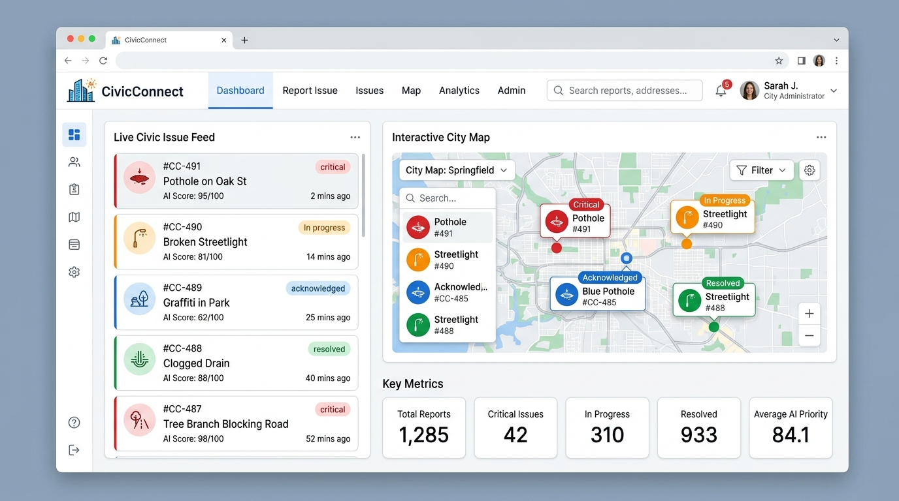

# Aman Sharma | Creative Developer Portfolio

> Immersive personal portfolio featuring 60 FPS HTML5 Canvas 3D Parametric Ribbons, RubberBand typography physics, interactive 3D rotating Tag Cloud sphere, and full production project showcases.



## 🚀 Live Demo
- **GitHub Pages**: [https://codingwithaman1.github.io/aman-portfolio/](https://codingwithaman1.github.io/aman-portfolio/)
- **Local Dev Server**: `http://localhost:3000/`

---

## ✨ Features
* **60 FPS Live 3D Ribbon & Attractor**: HTML5 Canvas mathematical space curves with dynamic mouse tilt, 3D orbit rotation, and interactive customization controls panel.
* **RubberBand Letter Hover Effects**: Organically squishing and stretching typography with dual-tone neon glowing letters.
* **Interactive 3D Sphere Tag Cloud**: Fibonacci spiral projected 3D sphere rotating in real-time with cursor inertia.
* **Extracted Showcases from Aman Sharma's Portfolio**:
  * **CivicConnect**: AI Civic Action platform with Google Gemini Vision AI & GPS clustering.
  * **Inventra**: Smart Cloud Inventory SaaS with SQLAlchemy 2.0 & Chart.js.
  * **MyRail**: Real-time Indian Railway PNR & train tracker.
  * **Amanzon**: E-commerce responsive storefront.
* **Integrated Resume**: Direct one-click download for `Aman-Sharma-Resume.pdf`.
* **Futuristic Web Audio API**: Subtle tactile sound effects with one-click mute/unmute control.
* **Interactive Contact Section**: Responsive form with celebratory particle confetti showers (`canvas-confetti`).

---

## 🛠️ Tech Stack
* **Core Framework**: React 18, Vite 6
* **Styling**: Tailwind CSS v4, Lucide React
* **Graphics & Animation**: HTML5 Canvas (3D Math & Harmonic Oscillators), CSS3 Keyframes
* **Audio**: Web Audio API (Synthesized Real-time Audio)
* **Effects**: Canvas-Confetti

---

## 💻 Local Development

```bash
# Clone the repository
git clone https://github.com/CodingWithAman1/aman-portfolio.git

# Install dependencies
npm install

# Start development server
npm run dev

# Build for production
npm run build
```

---

## 📬 Contact
- **Email**: [codewithaman88@gmail.com](mailto:codewithaman88@gmail.com)
- **WhatsApp / Phone**: [+91-9690683156](https://wa.me/919690683156)
- **LinkedIn**: [linkedin.com/in/aman-sharma-web](https://www.linkedin.com/in/aman-sharma-web/)
- **GitHub**: [github.com/CodingWithAman1](https://github.com/CodingWithAman1)
